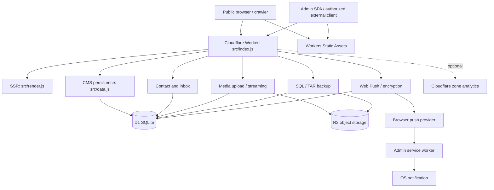
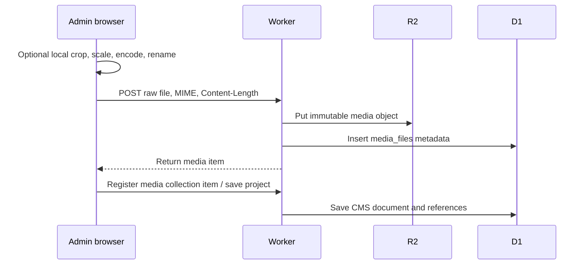

# Portfolio OS — Personal Portfolio & Custom CMS

A multilingual personal portfolio and purpose-built content management system, running on Cloudflare Workers, D1 and R2. The application combines server-rendered public pages, a vanilla JavaScript administration SPA, authenticated content APIs, browser-side media processing, visitor analytics, portable SQL backups and encrypted Web Push notifications.

**Production website:** [maher2004.dev](https://maher2004.dev) · **Admin:** [/admin](https://maher2004.dev/admin)

This document is the architectural entry point for developers and AI coding agents. It describes repository behavior, not a guarantee that every feature is deployed or that a particular production account is configured. The implementation and tests are authoritative; inspect them before changing behavior.

## Contents

- [Architecture](#architecture)
- [Repository map](#repository-map)
- [Features and workflows](#features-and-workflows)
- [Persistence and data model](#persistence-and-data-model)
- [HTTP API reference](#http-api-reference)
- [Security and privacy](#security-and-privacy)
- [Web Push and cryptography](#web-push-and-cryptography)
- [Local development](#local-development)
- [Configuration and deployment](#configuration-and-deployment)
- [Backup and recovery](#backup-and-recovery)
- [Testing and troubleshooting](#testing-and-troubleshooting)
- [Maintainer and AI-agent guide](#maintainer-and-ai-agent-guide)
- [Known limitations](#known-limitations)

## Architecture

This is a single Worker application with modular handlers, not an Express server or a set of independently deployed microservices. No React build pipeline, persistent application server, WebSocket server or traditional operating-system deployment is required. Node.js is used for development tooling and offline tests, not as the production runtime.



### Runtime responsibilities

| Layer | Implementation | Responsibility |
|---|---|---|
| Edge HTTP | Cloudflare Workers, JavaScript ES modules | Routing, authorization, validation, orchestration, security headers |
| Public UI | SSR HTML plus vanilla JS/CSS | Crawlable public pages, client interaction, localized content |
| Admin UI | Vanilla JavaScript SPA | Editing, media processing, publication, inbox, device management and exports |
| Structured storage | D1 (SQLite) | JSON documents, configuration, contact messages, media metadata, analytics, throttling and device subscriptions |
| Binary storage | R2 | Original or browser-processed files, served through stable Worker URLs |
| Async processing | Worker execution context `waitUntil()` | Best-effort visit recording and post-commit notifications |
| External integration | REST, Python standard-library CLI | Authorized content management without using the dashboard |
| Development | npm, Wrangler, Node test runner, Python | Local bindings, migrations, tests, deployment tooling |

### Request lifecycle

1. Cloudflare routes configured dynamic paths to the Worker; static assets are served using the assets binding.
2. `src/index.js` handles preflight/origin rules and authenticates every `/api/admin/*` request before invoking private handlers.
3. A handler reads or validates input, uses D1/R2 as appropriate, and returns HTML, JSON or a binary response.
4. The Worker applies security headers and permitted CORS headers to its responses.
5. Public page requests schedule aggregated pageview recording. Successful contact inserts schedule push delivery after the D1 transaction commits.

No authentication token is necessary to read published portfolio content. The admin HTML shell is public but private data and mutations are protected by the API.

## Repository map

| Path | Purpose |
|---|---|
| `src/index.js` | HTTP entry point, routes, auth, origin checks, throttling, analytics, uploads, robots and sitemap |
| `src/data.js` | CMS state hydration, public filtering, validation, snapshot writes and collection operations |
| `src/render.js` | Public SSR and admin HTML shell, localized SEO metadata |
| `src/defaults.js`, `data/defaults.json` | Initial content/configuration; not a production database dump |
| `src/contact.js` | Contact normalization, phone validation, inbox metadata and auxiliary tables |
| `src/presentation.js` | Shared public presentation helpers |
| `src/skill-order.js` | Stable ordering of hard skills, catch-all engineering group last |
| `src/media-usage.js` | Reference discovery for deletion guards |
| `src/media-response.js` | R2 media streaming, HEAD, byte ranges and If-Range |
| `src/sql-backup.js` | SQLite schema discovery, foreign-key-aware SQL serialization |
| `src/backup-export.js` | SQL download and streaming TAR construction |
| `src/web-push.js` | Device persistence, VAPID, provider transport, authenticated push endpoints |
| `src/push-encryption.js` | RFC 8291 / 8188 encryption and bounded contact preview generation |
| `public/app.js`, `public/app.css` | Browser state, public UI, admin UI, forms, events and styles |
| `public/media-studio.js`, `public/media-studio.css` | Interactive media conversion/editor |
| `public/media-transform.js` | Format, geometry, limits, quality and video bitrate calculations |
| `public/media-editor-controls.js` | File naming, batch controls and editor helpers |
| `public/media-image-worker.js` | Background image processing |
| `public/media-webm-index.js` | WebM metadata and seeking support |
| `public/backup-export.js` | Download controls, streamed file writing and bounded fallback |
| `public/push-settings.js` | Inline Notifications tab, registration, preview upgrades, tests and removal |
| `public/push-registration.js` | Service worker discovery, registration and activation checks |
| `public/push-sw.js` | Push display and notification click handling; no fetch/cache handler |
| `public/admin.webmanifest`, `public/_headers` | Admin install metadata and service-worker response headers |
| `public/demos/` | Optional static demos, deployed as assets rather than CMS files |
| `database/0001_init.sql`, `database/0002_seed.sql` | Initial schema and generated seed migration |
| `scripts/deploy.sh` | Initial Cloudflare provisioning (not routine update workflow) |
| `scripts/seed_sql.py` | Generates seed SQL from defaults |
| `scripts/generate-push-key.mjs` | Generates persistent P-256 VAPID private JWK |
| `scripts/portfolio_agent.py` | Authenticated project/media CLI |
| `tests/*.test.mjs` | Offline regression and integration tests |
| `wrangler.jsonc`, `package.json`, `package-lock.json` | Runtime bindings, dependency versions and development scripts |
| [docs/API.md](docs/API.md) | Additional API examples and payload details |
| [docs/WEB_PUSH.md](docs/WEB_PUSH.md) | Push setup, enrollment and operational diagnostics |
| [skills/portfolio-cms/SKILL.md](skills/portfolio-cms/SKILL.md) | Instructions for agents operating live CMS content |

Historical update notes are not current architecture contracts. Prefer source and tests to historical descriptions.

## Features and workflows

### Public portfolio and localization

- Homepage, project case studies and focused share pages have real URLs and SSR HTML; public data is embedded in an escaped JSON script for browser rendering.
- English is the fallback. Arabic uses localized fields and RTL layout; Spanish is optional via settings. Missing translations fall back to English.
- Project filters derive from published projects' `tracks`. A project may belong to several areas. Focus links contain selected project IDs and matching tracks.
- `published` determines public eligibility; `featured` only prioritizes eligible projects on the homepage. Draft previews run within the authenticated dashboard; there is no public draft preview API.
- Project covers and ordered gallery media are distinct. The public UI supports image/video viewing, thumbnails and native video controls.
- Metadata, canonical URLs, language alternates, structured data and sitemap help discovery; they do not guarantee search indexing or ranking.
- Homepage branding, portrait, sections, section ordering, professional identity, skills, experience, certificates, social links, offers and downloadable CVs are CMS-managed.
- The Other Engineering hard-skill group (ID `hard-other` or matching English name) remains last while preserving other groups' relative order.

### Admin SPA

Open `/admin` and enter the portfolio admin token. The browser retains it in JavaScript memory only. Refreshing or locking the dashboard ends that UI session. Locking does not revoke the server secret or disable existing push subscriptions.

Sidebar tabs: Overview, Projects, Share Links, Homepage, Experience, Skills, Offers, Sections, Certificates, Social Links, Media Library, Inbox, Notifications, Visitor Analytics, Export / Backup, Settings.

The SPA loads the authenticated state, edits objects locally and serializes save requests. Backend validation is independent of browser controls. The UI can save complete snapshots; external clients should prefer item endpoints and preserve unknown fields. Snapshot writes are intended for one editor, not conflict-free concurrent collaboration.

### Media upload, editing and retrieval



- Raw upload cap: **90 MiB**, nonempty body with known Content-Length; no multipart wrapper or base64 embedding.
- Accepted output MIME types: PNG, JPEG, WebP, GIF, AVIF, MP4, WebM, PDF, JSON, plain text. Browser codec support determines which conversions are available.
- Image editing uses Canvas and, where available, Web Workers/OffscreenCanvas; source image limit 90 MiB and decoded image budget 24 million pixels. Video uses MediaRecorder and optional Web Audio; it can take real playback time.
- Preserve compatible MP4/WebM by default rather than force lossy conversion. Optional video encoding supports dimension-aware automatic bitrate, manual bitrate, frame rate, audio settings and output size checks. WebM indexing repairs duration/seek metadata where needed.
- Cropping, independent horizontal/vertical scaling, batch conversion, filename prefixes, paginated library and edit-as-copy are client features, not Worker conversion APIs.
- Object key format: `media/<uuid>.<ext>`. Display names are metadata; rename preserves ID, object key and extension.
- Generic upload creates binary and `media_files` metadata, but does not by itself add the CMS media document. Register the returned item in `collections/media` before attaching references. Portrait upload handles registration automatically. Legacy CV upload sets `settings.cvUrl`; named CVs use `settings.cvs`.
- A guarded deletion checks current references (including drafts), returns 409 when used, and removes R2 plus both metadata records when unreferenced. Editing a copy must never silently replace references.
- GET /media/:id streams the object. HEAD reports metadata. Single byte ranges return 206; invalid/unsatisfiable ranges return 416 with Content-Range. If-Range mismatch returns full content. Non-PDF media has long immutable caching; PDF has inline disposition and shorter caching.
- **Media IDs are public URLs.** An unpublished project does not make its referenced binary private. Do not upload confidential files merely because a project is a draft.

### Contact, inbox and notifications

Public form supports email, WhatsApp and Telegram as contact methods. These are contact preferences, not automatic outbound messages to those networks. The phone library normalizes and validates numbers using country information. The honeypot quietly acknowledges suspected bots without inserting messages. IP-based contact throttling is applied when a connecting IP is present.

A successful request inserts `messages`, `message_details` and `message_countries` in a D1 batch. Only afterward is Web Push scheduled. The inbox returns up to 250 newest messages, including archived records, with read/archive actions and deletion. Device/browser summaries are derived from stored user agents, not verified device identities.

### Visitor analytics

D1 aggregates pageviews by UTC date, hour, country and full page path. Admin supports 7/30/90-day windows, daily trends, country distribution, hourly and page-level rankings. Prefetch requests are excluded where indicated by the request headers.

These are **pageviews, not unique visitors**. Bots, refreshes and repeated visits can be counted; country is approximate. Historical grouped paths cannot be retrospectively split. No visitor session duration is measured. Optional Cloudflare GraphQL analytics reports zone-wide HTTP requests and bytes, a separate metric.

## Persistence and data model

The CMS uses a document-oriented model over relational SQLite. Most CMS fields are JSON stored in two tables rather than one relational table per content type. Do not add arbitrary SQL columns for every project field. Binary files live in R2, not JSON or D1.

| Table | Key / important fields | Role |
|---|---|---|
| content_items | (collection,id), position, content JSON, updated_at | Ordered CMS documents |
| configuration | name, content JSON, updated_at | Single-value configuration records |
| messages | id, name, email, message, is_read, created_at | Contact inbox |
| message_details | id, method, phone, ip, user_agent, archived | Contact metadata |
| message_countries | id, ip_country, phone_country | Country metadata |
| media_files | id, unique object_key, name, mime_type, bytes, created_at | R2 metadata |
| visit_hours | (date,hour,country,path), views | Aggregated pageviews |
| auth_attempts | ip_hash, failures, window_start | Failed admin authorization throttling |
| contact_limits | ip_hash, hits, window_start | Contact throttling |
| push_devices | id, endpoint, public_key, label, created_at | Push subscription records |
| push_device_keys | id FK to push_devices ON DELETE CASCADE, vapid_key, p256dh, auth | Per-subscription encryption material |

The first migration creates base tables. Contact detail/country and push tables are created lazily by their respective handlers using CREATE TABLE IF NOT EXISTS. The second migration seeds default documents/configuration. Not all logical relationships are declared foreign keys: contact detail cleanup and media reference safety are explicitly handled in application code.

### CMS collections

`projects`, `experience`, `socials`, `views`, `hardSkills`, `softSkills`, `certificates`, `offers`, `customSections`, `media`.

Configuration keys: `hero`, `settings`, `brand`, `sections`, `sectionsOrder`. The state also includes messages, but those are not a CMS collection. `sectionsOrder` is an ordered array; other configuration fields are objects according to the defaults.

`readSite()` starts from defaults, loads ordered D1 records, normalizes hard skills and optionally attaches the inbox. Public reads exclude unpublished projects, inactive offers/views, hidden or empty custom sections and unrelated media metadata; messages are empty.

`putState()` validates the entire state, assigns positions and uses batched upsert/delete operations. It also updates submitted inbox read flags separately. Item and collection APIs internally read and write the whole CMS snapshot; they are **not** independent SQL row-level updates and do not avoid snapshot limits or concurrent-edit risks.

Limits in code: 500 items per collection, 900,000 serialized state characters, 220 SQL statements per snapshot batch, no embedded media base64, project ID ASCII slug up to 90 characters, title up to 240 characters, at most 20 tracks, general item ID up to 120 allowed ASCII characters. Named CV list max 25; SEO title/description limits 160/450 characters. These are application limits, not promises about platform capacity.

### Project document contract

```json
{
  "id": "example-project",
  "title": "Example Project",
  "titleAr": "",
  "titleEs": "",
  "category": "Web Application",
  "summary": "Short card description.",
  "overview": "Non-technical project story.",
  "problem": "The challenge.",
  "solution": "The approach.",
  "technicalDetails": "Implementation details.",
  "role": "Backend Development",
  "tracks": ["Backend", "Full-stack"],
  "stack": ["JavaScript"],
  "features": ["A verified feature"],
  "featuresAr": [],
  "featuresEs": [],
  "year": "2026",
  "status": "In progress",
  "tone": "blue",
  "github": "",
  "demo": "",
  "links": [],
  "coverMediaId": "",
  "mediaIds": [],
  "gallery": [],
  "published": false,
  "featured": false
}
```

Localized scalar fields: title, category, summary, overview, problem, solution, role, technicalDetails, seoTitle, seoDescription support Ar/Es suffixes. Highlights are arrays (features/featuresAr/featuresEs); stack and tracks are arrays shared across languages. Links are objects with id, label, url. Legacy github/demo/gallery remain supported. Media documents use id, name, type, src, bytes and optional additional metadata. Preserve unknown fields and translations during edits.

## HTTP API reference

Base URL: production HTTPS origin or local Wrangler URL. JSON unless stated otherwise. All admin routes require `Authorization: Bearer <ADMIN_TOKEN>`. Same-origin UI requests work without CORS setup; authorized cross-origin browser clients require explicit ALLOWED_ORIGINS. Server-side clients generally do not send Origin.

### Public endpoints

| Method | Path | Contract |
|---|---|---|
| GET | / | Public homepage HTML |
| GET | /projects/:slug | Published project HTML; 404 when unavailable |
| GET | /focus/:slug | Active focused share page; 404 when unavailable |
| GET | /admin | Admin HTML shell; noindex, no private state |
| GET | /api/site-data | Filtered public CMS state |
| GET | /api/contact/options | country (nullable), callingCodes map by ISO country |
| POST | /api/contact | Validate and store contact; 201 {ok:true} on success |
| GET, HEAD | /media/:id | Public binary/metadata, single range support on GET |
| GET | /cv | Legacy CV PDF attachment or 404 |
| GET | /cv/:id | Named CV PDF; ID refers to CV entry, not media UUID |
| GET | /robots.txt | Crawling directives |
| GET | /sitemap.xml | Published project, active focus and eligible language URLs |
| GET, HEAD | Static asset paths | Worker assets or configured static asset routing |
| OPTIONS | Preflight | Origin check; permitted origins receive 204 |

Contact example:

```json
{"name":"Example sender","message":"I would like to discuss a project.","contactMethod":"email","email":"sender@example.com","website":""}
```

For WhatsApp/Telegram use contactMethod, phone and country (ISO country code for local numbers). Name is trimmed to 100 characters, message to 3000; minimum lengths are 2 and 8 respectively. Email max 200. Contact body limit 8000. Honeypot website is expected empty. Rate limit: five accepted attempts per IP window of ten minutes when IP is available; 429 includes Retry-After. A honeypot response may be 200 with no stored message.

### Admin CMS and operational endpoints

Paths below are relative to `/api/admin`.

| Method | Path | Request / response |
|---|---|---|
| POST | /verify | Token check; {ok:true} |
| POST | /seed | Seed only when configuration is uninitialized; {created:boolean} |
| GET | /state | Complete editable snapshot plus inbox |
| PUT | /state | Full snapshot; {ok:true}; omitted documents in submitted collections are removed |
| GET | /collections/:collection | Ordered collection array |
| PUT | /collections/:collection | Replace collection with supplied array; {ok:true} |
| GET | /collections/:collection/:id | Item or JSON null |
| PUT, POST | /collections/:collection/:id | Full item upsert; path and body id must agree; returns item |
| DELETE | /collections/:collection/:id | Remove CMS record; {ok:true}; not binary media deletion |
| POST | /files?name=... | Raw binary upload; returns {id,name,type,src,bytes}, 201 |
| PATCH | /files/:id | {name}; rename metadata in both tables, preserve extension; returns {id,name} |
| GET | /files/:id/references | {id,used,references} including draft uses |
| DELETE | /files/:id | Guarded binary and metadata deletion; 409 if referenced |
| PUT | /portrait?name=... | Raw image, upload + register + update portrait; 201 |
| PUT | /cv | Raw PDF, legacy CV configuration; 201 |
| GET | /messages | Up to 250 most recent inbox entries |
| PATCH | /messages/:id | {read:boolean} and/or {archived:boolean}; {ok:true} |
| DELETE | /messages/:id | Delete message and associated metadata; {ok:true} |
| GET | /analytics?days=30 | D1 pageviews; 7, 30, 90 accepted |
| GET | /analytics/cloudflare | Optional zone-level daily GraphQL metrics |
| GET | /export?parts=database | Complete application SQL dump |
| GET | /export?parts=database,media | Streamed TAR: backup.sql and registered R2 objects |

Collection upsert is **replacement, not PATCH**. Read before writing and merge explicitly. The Python helper performs its own shallow merge for project updates; direct HTTP calls do not.

### Admin notification endpoints

All are under `/api/admin/push`.

| Method | Path | Contract |
|---|---|---|
| GET | / | {configured,publicKey?,devices}; device id, label, created_at, active, preview flags; no endpoint/auth key disclosure |
| POST | /subscribe | {endpoint,publicKey,label,keys?}; optional keys={p256dh,auth}; 201 {id} or 409 if device limit reached |
| POST | /devices/:id/test | Send generic or encrypted sample; {status,accepted,expired,reason?} |
| DELETE | /devices/:id | Remove subscription; {ok:true}; related encryption keys cascade |

Device ID is SHA-256 of endpoint, lowercase 64-digit hex. Public key must match the configured VAPID key. Existing clients omitting keys do not erase previously stored preview credentials. Device cap is five including old-key devices. Subscription request body cap 4096. A test is an actual external push request; provider acceptance is not proof that a device displayed it.

### HTTP errors and client behavior

| Status | Typical meaning |
|---|---|
| 400 | Invalid input, JSON, IDs, or export selection |
| 401 | Missing/incorrect admin token |
| 403 | Disallowed request origin |
| 404 | Missing public resource, route or push test device; missing collection item instead returns null |
| 409 | Referenced media, device capacity or old VAPID key |
| 411 | Missing upload Content-Length |
| 413 | Upload exceeds size limit |
| 415 | Unsupported media MIME |
| 416 | Invalid/unsatisfiable byte range |
| 429 | Auth or contact rate limit |
| 503 | Push not configured or invalid VAPID configuration |
| 500 | Internal error; inspect sanitized operational logs |

Errors generally use {error:string}; some include additional fields. Do not assume every exception maps to 400. Do not retry mutations blindly: read back state after ambiguous failures.

### Safe API example (read only)

```bash
read -rsp 'Portfolio admin token: ' TOKEN; echo
curl -fsS https://maher2004.dev/api/admin/collections/projects \
  -H "Authorization: Bearer $TOKEN"
unset TOKEN
```

Run against authorized environments only. Do not copy private responses into public logs or AI prompts.

## Security and privacy

The design treats the browser as untrusted; hiding a button is not authorization. Security controls are implemented application-level safeguards, not an independently audited security guarantee.

| Area | Implemented controls / boundary |
|---|---|
| Authentication | Random 32-byte token provisioned as Worker secret; SHA-256 digest comparison; token required on every admin route; input token length bounded |
| Session handling | In-memory browser token; no auth cookie/localStorage; reload/lock clears UI session; server has one shared admin credential, no roles or individual session revocation |
| Abuse mitigation | Failed-auth IP throttling (12 attempts / 900 seconds); contact limit five / 600 seconds; honeypot; bounded input/upload sizes |
| SQL injection | Parameterized D1 statements; dynamic identifiers and SQL fragments must be validated/controlled; SQL backup quotes stored values inside SQLite |
| Browser boundaries | Origin checks on APIs; explicit CORS allowlist; CSP, X-Frame-Options DENY, nosniff, Referrer-Policy, Permissions-Policy; inline PDF preview exception allows same-origin framing |
| XSS | Escape untrusted HTML and attributes, safe embedded JSON and constrained links; do not introduce raw HTML interpolation |
| Media integrity | UUID object keys, MIME allowlist, known length, upload compensation on metadata failure, reference checks before deleting |
| Push transport | HTTPS provider host allowlist, VAPID signing, redirect manual + reject 3xx, bounded transport timeout, encrypted optional previews |
| Secrets | ADMIN_TOKEN, PUSH_VAPID_JWK and optional CF_ANALYTICS_TOKEN stored outside source; never put them in public config or frontend bundle |
| Privacy | Public state excludes inbox and drafts; private exports are no-store; device endpoints/auth secrets not returned by management list; notification previews omit sender contact metadata |

MIME declarations alone are not malware scanning or proof of file content. CSP/CORS are defense-in-depth, not substitutes for authentication. Contact IP/user agent and country records are personal-data considerations. Notification previews can appear on lock screens. Logs must avoid authorization headers, push endpoints, encryption secrets and visitor message text. Maintain HTTPS and review retention/access policies.

Backups may contain private messages, IP information and push subscription credentials; protect them as secrets. Never commit backup files, tokens or production data to Git. Review any historical backup artifacts already tracked in repository history; removing a file in a new commit does not purge prior copies.

## Web Push and cryptography

```mermaid
sequenceDiagram
  participant B as Admin browser
  participant W as Worker
  participant D as D1
  participant P as Browser push provider
  participant S as Service worker
  B->>W: GET push configuration (authenticated)
  W-->>B: VAPID public key and device summaries
  B->>B: Permission, register worker, subscribe
  B->>W: Endpoint, VAPID key, p256dh/auth keys
  W->>D: Persist subscription
  Note over W,D: Contact message committed
  W->>D: Read matching device subscriptions
  W->>W: Sign VAPID JWT; encrypt per device
  W->>P: HTTPS POST, encrypted aes128gcm body
  P->>S: Push event / browser decrypts
  S->>S: Show OS notification
```

### Two different cryptographic purposes

**VAPID (RFC 8292)** authenticates the sending application server. A persistent P-256 key pair is generated once. The private JWK stays in Worker secrets; the public key is passed to PushManager.subscribe. The Worker creates an ES256-signed JWT with the provider origin as audience, a one-hour expiry and the configured subject (currently hardcoded to the production HTTPS origin). VAPID does not itself encrypt message content.

**Payload encryption (RFC 8291 and RFC 8188)** protects notification contents from intermediary push services. The browser provides a P-256 public encryption key (p256dh) and 16-byte authentication secret. The Worker generates a fresh ephemeral ECDH key pair and random 16-byte salt per recipient/message. HKDF-SHA256 derives input key material using the auth secret and WebPush info, then derives a 128-bit AES key and 96-bit nonce. AES-128-GCM encrypts the JSON payload with final-record delimiter; the RFC 8188 header carries salt, record size and sender public key. Native Web Crypto primitives perform the operations; no third-party crypto library is required. This is standards-based composition of primitives, not a new encryption algorithm.

Notification content: sender name and normalized preview of up to 100 Unicode code points (ellipsis included when truncated). No email, phone or IP is included. Legacy subscriptions without encryption keys receive an empty push and generic alert. Existing devices can enable message previews without rotating VAPID; the browser supplies its current subscription keys. Encryption failure returns a diagnostic instead of sending plaintext.

Provider endpoints are restricted to known HTTPS push hosts. Requests use manual redirects and do not forward credentials; TTL 3600 seconds, normal urgency, eight-second transport timeout. Expired 404/410 subscriptions are removed. There is no guaranteed delivery, durable queue or retry policy. The inbox is authoritative even when push fails.

### Setup and operation

Use the Notifications tab in an authenticated dashboard. Enable the current device, grant browser permission, then use the device Test action. Existing devices may require the one-time Enable message previews action. Android and desktop do not require installing the app; supported iOS/iPadOS requires installation to Home Screen. Permission alone is not a subscription.

The dedicated worker is /push-sw.js, scope /admin, with no caching/fetch handler. Notification clicks open /admin?tab=inbox and still require admin login. Manifest and service-worker headers are in public assets. Do not broaden scope or add caching of private state without a deliberate design review.

See [Web Push operational guide](docs/WEB_PUSH.md) for details.

## Local development

Use Node.js 22+ (recommended for SQLite integration tests), npm, Python 3 and Wrangler. The original provisioning script expects Node 20+; check the pinned Wrangler version's engine requirements. No frontend build step is required.

```bash
git clone https://github.com/MoMaher2004/portfolio.git
cd portfolio
npm ci
npx wrangler d1 migrations apply maher-portfolio-db --local
# Create .dev.vars locally with a separate development ADMIN_TOKEN.
npm run check
npm test
npm run dev
```

Wrangler uses local simulated storage by default unless remote bindings are explicitly requested. Use synthetic local content and a development token, not a production export. For local push experiments generate a separate dev VAPID JWK and put it in local .dev.vars, use a supported secure context and an authorized device. Do not rotate production keys for local testing.

Regenerate the seed migration using `python3 scripts/seed_sql.py` only when deliberately changing defaults. An already-applied migration is not a content update mechanism. New schema changes should use new migrations or explicitly idempotent runtime initialization.

## Configuration and deployment

| Name | Kind | Purpose |
|---|---|---|
| DB | D1 binding | Database maher-portfolio-db |
| FILES | R2 binding | Bucket maher-portfolio-media |
| ASSETS | Static assets binding | public/ |
| SITE_ORIGIN | Variable | Intended site origin |
| ALLOWED_ORIGINS | Variable | Comma-separated exact permitted external origins |
| CLOUDFLARE_ZONE_ID | Variable | Optional zone analytics |
| ADMIN_TOKEN | Secret | Administrative bearer credential |
| PUSH_VAPID_JWK | Secret | Persistent private P-256 JWK |
| CF_ANALYTICS_TOKEN | Secret | Optional read-only zone analytics API credential |

Wrangler configuration declares bindings and dynamic routes that run Worker-first. Preserve actual deployment bindings and compatibility date unless intentionally changing infrastructure. The current production deployment is GitHub-connected; the main branch is the ordinary deployment path. No GitHub Actions workflow is present in the inspected tree, so do not infer CI checks run remotely.

For initial provisioning only, `bash scripts/deploy.sh YOUR_DOMAIN` checks login, creates/reuses resources, updates Wrangler configuration, applies remote migrations, deploys, and provisions ADMIN_TOKEN using a local .secrets file. It can print or reset the production token; do not rerun casually. A custom domain requires an active Cloudflare zone. R2 billing activation may be required even within free allowances.

For routine maintenance:

```bash
git status --short
git diff --check && npm run check && npm test
# Review changes; stage only the intended paths.
# Commit and push main only when authorized, then verify Cloudflare build.
```

Apply required production migrations deliberately before code relying on them; do not assume a Git push applies remote migrations. Check Worker logs and production smoke tests after deployment. Content API edits modify D1 directly and do not require a deployment.

### Production VAPID setup (once)

```bash
mkdir -p "$HOME/.config/maher-portfolio"
chmod 700 "$HOME/.config/maher-portfolio"
(umask 077; set -C; node scripts/generate-push-key.mjs > "$HOME/.config/maher-portfolio/push-vapid.json")
npx wrangler secret put PUSH_VAPID_JWK < "$HOME/.config/maher-portfolio/push-vapid.json"
```

If the file exists, reuse it rather than regenerate it. Keep a secure separate backup of the key. Changing the key requires affected subscriptions to be recreated; never publish the private JWK.

## Backup and recovery

Export / Backup offers a SQL-only export or SQL plus original registered R2 objects in a streamed TAR. It reads actual SQLite schema and rows, not the filtered CMS JSON. The SQL serializer discovers columns and foreign keys, orders tables parent-first where possible, emits explicit indexes before rows and views/triggers afterward, preserves SQLite literal representations (including BLOBs and embedded NUL text), and handles sqlite_sequence if present.

- Includes all visible application tables, including inbox, analytics, push subscriptions and encryption keys.
- Excludes Cloudflare/internal SQLite metadata (apart from sqlite_sequence handling), Worker secrets, external analytics and unregistered/orphan R2 objects.
- SQL cap 32 MiB; browser fallback without direct-to-disk support capped at 64 MiB. R2 objects stream without loading the entire archive in Worker memory.
- Database rows are read in a D1 batch; R2 export is separate, not a cross-service atomic snapshot. Missing/changed files fail the stream; verify X-Export-Bytes and archive completeness.
- Virtual tables are explicitly unsupported by the custom SQL exporter. No automatic restore API exists.

Restore only into a fresh database, not the active production database. For a local SQLite restore:

```bash
sqlite3 -bail restored.db "PRAGMA foreign_keys=ON; BEGIN;" ".read backup.sql" "COMMIT;" "PRAGMA foreign_key_check;"
```

The dump emits defer_foreign_keys and no explicit BEGIN/COMMIT because D1 imports manage transactions. Validate D1-specific imports in an isolated database, including migration history, before switching bindings. Restore media separately to their original object keys. Keep VAPID and other Worker secrets separately. For larger/unsupported exports use Wrangler D1 export and a separate R2 backup workflow. Always verify the restored database and files; an export alone is not a tested disaster-recovery plan.

## Testing and troubleshooting

`npm run check` performs syntax checks on index.js, data.js, render.js and app.js; it is not a complete linter or type checker. `npm test` runs tests/*.test.mjs using Node's native test runner. Prefer Node 22+ to avoid skipping tests that require node:sqlite.

Test coverage areas include snapshot/API behaviors, media reference guards, range parsing/streaming, media geometry and bitrate, WebM-related behavior, gallery interactions, SEO, draft previews, skills order, SQL/TAR export, push registration, enrollment UI states, VAPID signatures, provider transport, subscription persistence and encryption. Inspect specific tests for the actual assertions; test count is not a claim of exhaustive coverage.

| Symptom | Investigation |
|---|---|
| Admin 401/429 | Check correct environment/token; stop repeated failed auth; never log token |
| Contact rejection | Inspect method-specific validation, country and Retry-After |
| Upload 411/413/415 | Ensure raw known-length file, supported MIME, <=90 MiB |
| Media 409 | Read references and obtain permission before detaching; never bypass guard |
| Video seek issues | Check GET/HEAD range response and WebM metadata; original source quality matters |
| Draft unexpectedly exposed | Inspect public state filters, SSR and sitemap; remember asset URLs remain public |
| Push button unavailable | Check browser support, site permissions, server configured flag and registration state |
| Service worker AbortError | Check /push-sw.js HTTP status/MIME/headers, normal browser profile, site storage and browser version; existing phone delivery may rule out server transport |
| Push status 0 | No HTTP response; inspect sanitized reason (network, timeout, signing, encryption or key issue) |
| Push 3xx | Redirect rejected deliberately; do not follow provider redirect |
| Provider accepts but device silent | Check browser/OS permissions, subscription, worker activation and lock-screen settings |
| Export incomplete | Check X-Export-Bytes, registered file consistency, caps and Worker logs |
| Production not updated | Check Git branch and Cloudflare deployment result; do not assume push implies live success |

Offline tests cannot demonstrate delivery through real browser push services, actual production D1/R2 behavior, search indexing or end-to-end browser compatibility. For changes in these areas, conduct targeted smoke tests with explicit authorization.

## Maintainer and AI-agent guide

### Choose the correct task boundary

- **Content-only work:** read [agent skill](skills/portfolio-cms/SKILL.md), then use authenticated CMS APIs or the Python CLI; do not modify repository source or seed data to edit live projects.
- **Code work:** inspect the current branch, relevant module, call sites, tests and actual API contract. Never infer implementation from the public portfolio's project description.
- **Infrastructure work:** inspect Wrangler bindings and deployment configuration; require explicit authorization before changing secrets, DNS, billing, production migrations or database bindings.

### Recommended sequence for any code change

1. Establish current Git ref and working tree. Do not overwrite unrelated local edits.
2. Read the relevant source files and regression tests; trace data from browser to API to storage and back.
3. Define expected behavior, failure paths and compatibility requirements. Preserve existing IDs, data and unknown document fields.
4. Make a focused change, using existing modules rather than duplicating logic; add tests for success and failure cases.
5. Update README and relevant API/agent/push documentation when a contract changes.
6. Run syntax checks and the full available test suite. Report skipped or unrun tests honestly.
7. Review diff for secrets, accidental exports, generated files and unrelated changes. Commit only intended files.
8. Push/deploy only with authorization. Verify production behavior separately.

### Where to edit

| Task | Start here | Also inspect |
|---|---|---|
| Add a CMS field | public/app.js, data/defaults.json | src/data.js, src/render.js, API schema, seed behavior |
| Change public layout | src/render.js, public/app.js, public/app.css | SSR/client parity, SEO, RTL, presentation tests |
| Add a private endpoint | src/index.js, domain handler | auth/origin gate, docs/API.md, tests, agent skill |
| Change ordering/filtering | src/data.js, src/skill-order.js, public/app.js | SSR, collection reads/writes and tests |
| Change media editor | public/media-studio.js, media-transform.js | worker, editor controls, WebM, upload constraints |
| Change media deletion | src/media-usage.js, src/index.js | draft refs, dual D1 metadata, R2 compensation |
| Change notifications | src/web-push.js, src/push-encryption.js | contact commit hook, service worker, UI, registration and crypto tests |
| Change backups | src/sql-backup.js, src/backup-export.js | client download, schema/restore tests, private data |
| Change analytics | src/index.js, public/app.js | UTC date grouping and metric semantics |

### Invariants to preserve

- Authenticate every admin route server-side, including new endpoints and device management.
- Never trust frontend authorization, prices or sensitive inputs merely because UI controls constrain them.
- Never expose ADMIN_TOKEN, private VAPID JWK, push endpoint/auth material, inbox or production dumps to public clients.
- Keep SSR and browser-generated content consistent. Preserve publication boundaries and localized metadata.
- Use stable media IDs and object keys; check all references before deletion. Do not bypass media guards using collection deletion.
- Preserve legacy subscriptions and document fields unless a migration is explicitly planned.
- Never send notification content unencrypted through a provider. Preserve the post-commit notification boundary and generic legacy behavior.
- Keep Other Engineering last after all specialized hard-skill groups.
- Avoid destructive bulk writes, blind retries and unauthorized production tests. Treat backup and restore as privileged operations.
- Do not fabricate achievements, security audits, performance measurements, test results or deployment status.

### External content agent

```bash
python3 scripts/portfolio_agent.py verify
python3 scripts/portfolio_agent.py list-projects
python3 scripts/portfolio_agent.py get-project example-project
# Mutating commands require user authorization:
# python3 scripts/portfolio_agent.py upsert-project --file project.json
# python3 scripts/portfolio_agent.py upload --file cover.webp --project example-project --cover
```

The CLI reads PORTFOLIO_ADMIN_TOKEN, the local authorized token file or a hidden prompt; PORTFOLIO_URL / --base-url selects the target. Do not grant an untrusted LLM the token or Cloudflare account credentials. The helper exposes a subset of routes; use the HTTP contracts for other authorized tasks. Fetch the current document first and preserve unknown fields. Prefer drafts unless publication is explicitly requested. Never run seed, delete or full-state replacement without authorization.

## Known limitations

- Single shared admin bearer token, no RBAC, multi-user editing or optimistic concurrency/version checks.
- Snapshot writes, including item operations, scale with total CMS size and remain subject to Worker/D1 limits.
- D1/R2 changes are not globally transactional; binary upload/delete and archive creation can have partial failures.
- Public asset URLs are not authenticated or expiring, including draft media.
- Rate limiting mitigates certain application-level abuse, not all DoS/DDoS. No CAPTCHA is currently implemented by the contact handler.
- Push delivery is best effort; no durable queue, retry scheduler, receipt guarantee or cross-device synchronization of OS display.
- Optional notification previews reveal limited message content on the receiving device; encryption does not protect against someone with device access.
- No universal media transcoding: browser codec capabilities, runtime and memory constrain processing.
- Pageview analytics is not user tracking, session analytics or bot-filtered traffic measurement.
- SQL backup has size and schema limits, excludes unregistered R2 files and secrets, and has no automated restore endpoint.
- Free-tier operation depends on Cloudflare quotas and account configuration; do not promise unlimited zero-cost hosting.
- Offline tests are not a production security audit or performance benchmark.

## Official technical references

- [Cloudflare Workers](https://developers.cloudflare.com/workers/)
- [Workers Static Assets](https://developers.cloudflare.com/workers/static-assets/)
- [Workers request API](https://developers.cloudflare.com/workers/runtime-apis/request/)
- [D1](https://developers.cloudflare.com/d1/)
- [R2 Workers API](https://developers.cloudflare.com/r2/api/workers/workers-api-usage/)
- [Workers limits](https://developers.cloudflare.com/workers/platform/limits/)
- [Cloudflare GraphQL analytics](https://developers.cloudflare.com/analytics/graphql-api/)
- [MDN Push API](https://developer.mozilla.org/en-US/docs/Web/API/Push_API)
- [MDN Service Worker API](https://developer.mozilla.org/en-US/docs/Web/API/Service_Worker_API)
- [RFC 8030 — HTTP Web Push](https://www.rfc-editor.org/rfc/rfc8030)
- [RFC 8292 — VAPID](https://www.rfc-editor.org/rfc/rfc8292)
- [RFC 8291 — Web Push encryption](https://www.rfc-editor.org/rfc/rfc8291)
- [RFC 8188 — Encrypted HTTP content encoding](https://www.rfc-editor.org/rfc/rfc8188)
